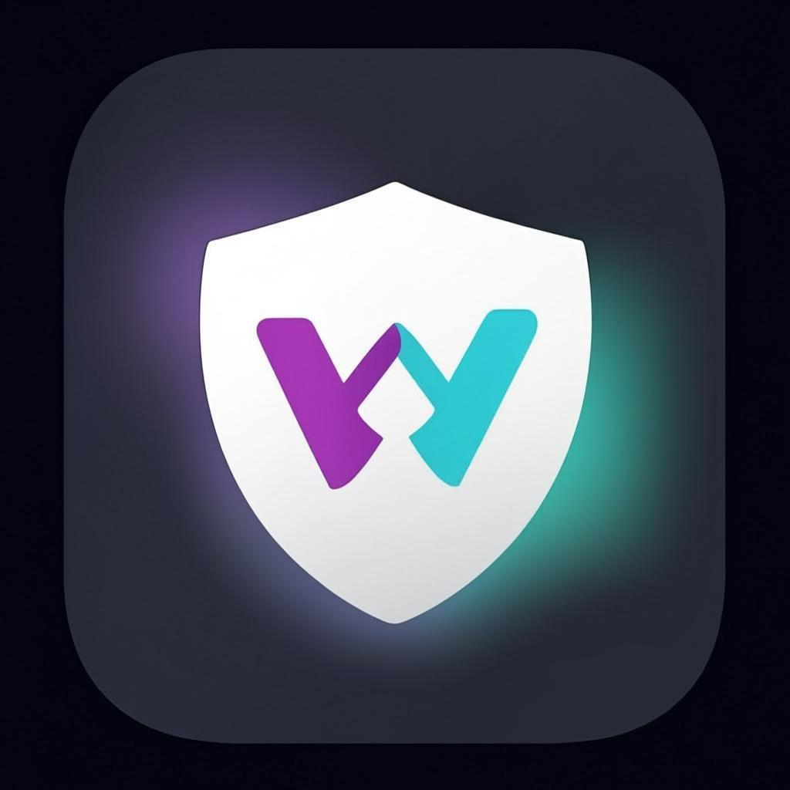

<div align="center">



# 🤍 WHITECHEATS • SCRIPTS

**Белые скрипты для Roblox — польза без вреда**

`client-side only`

[](loader.lua)
[](https://www.roblox.com)
[](#-структура-репозитория)

</div>

---

## 🛡 Кто мы такие

**WhiteCheats** — читерская компашка с белой совестью. Мы делаем скрипты для Roblox, которые **не вредят игре и игрокам**: никакой Fly, Noclip, Fling и прочей деструктивщины. Только честные client-side утилиты — визуальные и информационные.

| Можно у нас 🤍 | Нельзя у нас ⛔ |
| --- | --- |
| XP View, Local NPC, визуальные тесты | Fly, Noclip, Speed, Fling |
| UI-утилиты и информеры | Kill / Hitbox-эксплойты |
| Инструменты для проверки урона | Всё, что ломает игру другим |

> ⚠️ **Дисклеймер:** любой сторонний executor нарушает [Terms of Service Roblox](https://en.help.roblox.com/hc/en-us/articles/203313410). Использование — на твой страх и риск.

## 📦 Структура репозитория

Скрипты: `/scripts/{имя_скрипта-в-папке}/` — внутри `.lua`, `manifest.json`, `.svg` и т.д.
Загрузчик: `/scripts/loader.lua` — сам собирает информацию об актуальных скриптах.

```
scripts/
├── loader.lua          ← 🧭 загрузчик: авто-сборка каталога скриптов
├── catalog.json        ← 🔁 резервный каталог (если GitHub API недоступен)
├── assets/             ← 🎨 логотипы
│   ├── logo.png
│   └── logo.svg
├── _template/          ← 🧪 шаблон нового скрипта (loader его не показывает)
│   ├── manifest.json
│   ├── main.lua
│   ├── icon.svg
│   └── README.md
└── {имя-скрипта}/      ← 📁 одна папка = один скрипт
    ├── manifest.json   ← карточка скрипта
    ├── main.lua        ← точка входа
    └── icon.svg
```

## 🚀 Быстрый старт

1. Установи любой executor с поддержкой HTTP-запросов.
2. Запусти loader:

```lua
loadstring(game:HttpGet("https://raw.githubusercontent.com/whroblox/scripts/main/loader.lua"))()
```

3. Готово. Клавиша `RightControl` (или круглая кнопка «W») — показать/скрыть окно.

> Loader сам пройдётся по папкам репозитория, прочитает каждый `manifest.json` и соберёт карточки. Если GitHub API недоступен — автоматически переключится на резервный `catalog.json`.

## 🗂 manifest.json — карточка скрипта

```json
{
  "id": "damage-dummy",
  "name": "Damage Dummy",
  "version": "1.0.0",
  "author": "WhiteCheats",
  "description": "Локальный манекен для теста урона — виден только тебе. Кастомизация: скорость, одежда, аксессуары. Лог урона и DPS.",
  "entry": "main.lua",
  "icon": "icon.png",
  "tags": ["npc", "visual", "client-only", "damage-test"]
}
```

| поле | что это |
| --- | --- |
| `id` | имя папки скрипта |
| `name` | заголовок карточки |
| `description` | описание под заголовком |
| `version` | семвер |
| `entry` | файл запуска (по умолчанию `main.lua`) |
| `icon` | иконка карточки (`.svg` → символ, `.png` → картинка, если executor умеет `getcustomasset`) |
| `tags` | теги |
| `hidden` | `true` — скрыть из каталога |

Как карточка выглядит в loader:

```
┌──────────────────────────────────────────────┐
│ ┌────┐  Damage Dummy                 v1.0.0  │
│ │ ✦  │  Локальный манекен для теста урона    │
│ │    │  — виден только тебе. Кастомизация:   │
│ └────┘  скорость, одежда...     [ INJECT ]   │
└──────────────────────────────────────────────┘
```

## 🎨 Темы loader'а

| # | режим | как работает |
| --- | --- | --- |
| 1 | `dark` | тёмное стекло (принудительно) |
| 2 | `white` | светлое стекло (принудительно) |
| 3 | `system` | запоминает твой последний ручной выбор; если выбора не было — работает как `auto` |
| 4 | `auto` | днём (07:00–19:59) — `white`, ночью — `dark` |

Кнопка `THEME:` в шапке листает режимы по кругу. Roblox не даёт читать тему ОС, поэтому `system` работает через сохранённый выбор.

## 🧭 Как добавить свой скрипт

1. Скопируй `_template/` → переименуй папку в `имя-скрипта` (kebab-case).
2. Заполни `manifest.json`.
3. Код пиши в `main.lua` (или свой файл + поле `entry`).
4. Закоммить и запуш — loader подхватит папку автоматически.

## 📐 Правила оформления

| где | можно | нельзя |
| --- | --- | --- |
| репозитории | эмодзи и символы **только** в `.md` / `.txt` | эмодзи в коде |
| скрипты (`.lua`) | символы, SVG-иконки | **эмодзи — строго запрещены** |

## 📄 Лицензия

MIT — см. [LICENSE](LICENSE). Скрипты распространяются «как есть», без гарантий.

---

<div align="center">

**WhiteCheats** • white scripts, clean conscience

</div>
